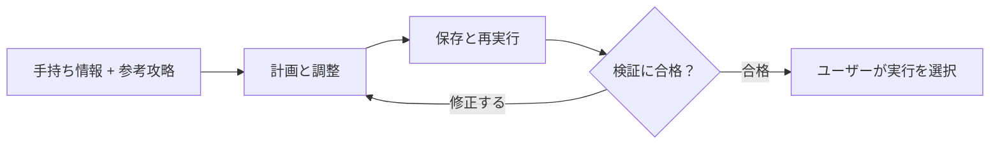

<div align="center">

# Arknights Strategy Workflow

**参考の攻略を、手持ちのオペレーターで使える作戦へ。**

育成状況に合わせた計画 · 試行と調整 · 保存した作戦の再検証

[English](README.md) · [简体中文](README.zh-CN.md) · **日本語**

[概要](#概要) · [処理の流れ](#処理の流れ) · [サンプルを実行](#サンプルを実行) · [設計メモ](docs/engineering-notes.md)

</div>

---

## 概要

攻略を見つけても、必要なオペレーターがいない、育成状況が違う、同じ順序では配置が間に合わない、といった理由でそのまま使えないことがあります。

**Arknights Strategy Workflow** は、参考攻略、保存したオペレーター情報、ローカルでの試行、再利用できる作戦を一つの流れにつなぐツールです。手持ちに合わせて候補を調整し、失敗した結果から改善案を作り、保存した作戦を実行前に確認します。

> このリポジトリでは、ローカルアプリの処理の流れと、一部の計画処理を動かせるサンプルを公開しています。ゲームと連携するアプリ全体はローカルで管理しています。

| 機能 | 役割 |
| :--- | :--- |
| **手持ちに合わせて計画する** | 所持オペレーターと記録された育成状況を条件に、参考攻略を調整します。 |
| **試行結果から修正する** | 失敗の記録をもとに、操作のタイミングや順序の変更案を作ります。 |
| **保存した作戦を再検証する** | 新しい条件で再実行し、過去に失敗した条件も確認します。 |
| **計画から実行へつなぐ** | 作戦と対応するオペレーター情報を一緒に保存し、ユーザーが選んで実行できるようにします。 |

## 処理の流れ



ローカルの画面では、オペレーター情報の更新、作戦の探索、演習、作戦実行をまとめて操作できます。探索と検証は同じ保存済み作戦を扱います。通常の実行では、LLMが戦闘中の操作を一つずつ判断する仕組みは使いません。

検証した構成では、演習を入口から結果確認まで実行できています。対応ステージ、オペレーターの動作、作戦の安定性はそれぞれ確認が必要です。幅広いアカウントへの適応や、別のタスクにも生かせる学習能力は、まだ確認できていません。

## 具体例：再配置が間に合わない

撤退したオペレーターの再配置が遅れると、作戦全体が失敗することがあります。そこで、記録をもとに変更できる箇所を探します。

公開している[タイミング調整モジュール](strategy_workflow/timing.py)は、撤退の記録、配置できる状態かどうか、コスト、失敗の時点を確認します。根拠がそろっている場合に、撤退前の待機時間を短くする案や、撤退の順序を早める案を作ります。既存の依存関係とイベント条件を保ち、元の入力も変更しません。

候補は改めて検証する必要があります。早く撤退すると別の場所を守れなくなる可能性もあるため、変更案を作る処理と、その効果を確認する処理を分けています。

## サンプルを実行

リポジトリをクローンまたはダウンロードし、ルートディレクトリから **Python 3.10以降** で実行します。追加パッケージは不要です。

```bash
python -m strategy_workflow.demo
python -m unittest discover -s tests -v
```

サンプルは**架空の失敗ケース**を読み込み、三つの変更案をJSONで出力します。テストでは、変更可能なケース、根拠の不足や矛盾、順序を変えられない条件、元の入力が保たれることを確認します。

このサンプルで動くのは、取り出した計画処理のみです。戦闘の評価やゲームアカウントへの接続は行いません。

| 内容 | 説明 |
| :--- | :--- |
| [計画処理](strategy_workflow/timing.py) | 根拠の確認と変更案の生成 |
| [入力例](examples/timing_case.json) | 架空の操作計画と失敗の記録 |
| [テスト](tests/test_timing.py) | 制約と変更を見送るケース |
| [設計メモ（英語）](docs/engineering-notes.md) | 再検証の設計と失敗情報を扱った事例 |

## 開発について

AIコーディングツールと協力しながら開発しました。私は実際の用途と確認すべき条件を決め、使用中に見つかった問題を伝え、修正の方向を調整しました。実装、テスト、デバッグにはAIツールを活用しています。作戦を確認し、保存して再利用できるよう、各処理をつなぐことに取り組みました。

ローカルアプリでは、ステージへの移動と編成準備の一部に [MAA](https://github.com/MaaAssistantArknights/MaaAssistantArknights) を使用しています。ゲーム素材、アカウント情報、ゲームとの連携部分は、このリポジトリには含まれません。外部コンポーネントの扱いと利用条件は[公開範囲と帰属](NOTICE.md)をご覧ください。

---

<sub>独立したプロジェクトであり、アークナイツの開発元・運営元とは関係ありません。</sub>
