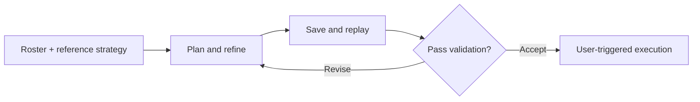

<div align="center">

# Arknights Strategy Workflow

**Adapt reference strategies to the operators you actually have.**

Roster-aware planning · Trial and refinement · Saved-plan validation

**English** · [简体中文](README.zh-CN.md) · [日本語](README.ja.md)

[Overview](#overview) · [Workflow](#workflow) · [Run the example](#run-the-example) · [Design notes](docs/engineering-notes.md)

</div>

---

## Overview

An Arknights guide can show a winning strategy while leaving you with a different roster, skill level, or deployment timing. Turning that reference into a usable plan takes more than copying its actions.

**Arknights Strategy Workflow** brings reference strategies, saved roster information, local trials, and reusable action plans into one workflow. It adapts a candidate to the available operators, uses failed trials to guide revisions, and checks the saved plan before making it available for execution.

> This repository presents the local application's workflow and selected planning code, with a runnable example. The complete game-connected application is maintained locally.

| Capability | What it contributes |
| :--- | :--- |
| **Plan around the roster** | Use available operators and recorded development levels as constraints when adapting a reference strategy. |
| **Revise from observations** | Propose changes to timing and action order using evidence from unsuccessful trials. |
| **Check the saved result** | Replay the saved plan under fresh conditions and revisit observed failures before accepting it. |
| **Keep the handoff consistent** | Carry the plan and its roster snapshot into user-triggered execution. |

## Workflow



The local interface brings roster updates, strategy search, practice, and battle execution together. Search and validation share the same saved-plan workflow; normal operation does not require an LLM to choose each battle action.

The prototype has completed end-to-end practice execution in tested setups. Supported stages, operator behavior, and plan reliability remain subject to validation; broad adaptation across accounts and learning across tasks have not been demonstrated.

## A closer look: redeployment timing

A plan can fail because an operator returns too late. The useful next step is to identify what can safely change.

The included [timing module](strategy_workflow/timing.py) examines the recorded withdrawal, deployment availability, resources, and failure timing. When the evidence supports it, the module proposes a shorter wait before withdrawal or an earlier withdrawal in the action sequence. Existing dependencies and event conditions stay intact, and the original input is preserved.

Each proposal still needs evaluation. Moving an operator away earlier may solve one problem and create another elsewhere in the battle.

## Run the example

Clone or download this repository, then run these commands from its root with **Python 3.10+**. No additional packages are needed.

```bash
python -m strategy_workflow.demo
python -m unittest discover -s tests -v
```

The demo reads a **synthetic failure case** and prints three candidate revisions as JSON. The tests cover supported revisions, missing or contradictory evidence, dependency barriers, and preservation of the input.

This example runs the extracted planning logic only. It does not evaluate a battle or connect to a game account.

| Explore | Contents |
| :--- | :--- |
| [Planning logic](strategy_workflow/timing.py) | Evidence checks and candidate generation |
| [Example input](examples/timing_case.json) | Synthetic plan and failure observations |
| [Tests](tests/test_timing.py) | Constraints and rejection cases |
| [Design notes](docs/engineering-notes.md) | Validation decisions and a failure-feedback case |

## Development

Built iteratively with AI coding tools. I defined the practical requirements and acceptance criteria, supplied feedback from actual use, and directed revisions. AI tools assisted with implementation, testing, and debugging. The engineering focus has been connecting these pieces into a workflow whose outputs can be checked and reused.

The full local application uses [MAA](https://github.com/MaaAssistantArknights/MaaAssistantArknights) for parts of stage entry and squad preparation. Game assets, account data, and execution integrations are outside this repository. See [scope and attribution](NOTICE.md) for component credits and terms.

---

<sub>Independent project. Not affiliated with or endorsed by the developers or publishers of Arknights.</sub>
