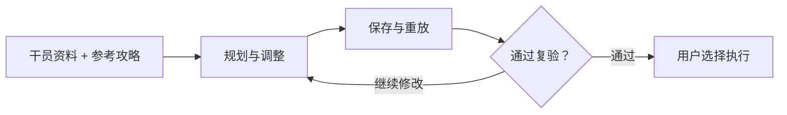

<div align="center">

# Arknights Strategy Workflow

**让参考攻略适应你实际拥有的干员。**

按练度规划 · 试打与调整 · 保存作业复验

[English](README.md) · **简体中文** · [日本語](README.ja.md)

[项目概览](#项目概览) · [工作流程](#工作流程) · [运行示例](#运行示例) · [设计说明](docs/engineering-notes.md)

</div>

---

## 项目概览

找到一份通关攻略之后，往往还差几步才能真正用起来：干员不齐、练度不同，或者同样的操作顺序在自己的队伍里赶不上时机。

**Arknights Strategy Workflow** 把参考攻略、已保存的干员资料、本地试打和可复用作业串成一个流程。它根据现有干员调整候选方案，从失败结果中寻找修改方向，再检查保存下来的作业是否满足执行条件。

> 本仓库介绍本地应用的工作流程，并提供精选的规划代码和可运行示例。完整的游戏接入应用保留在本地。

| 能力 | 解决的问题 |
| :--- | :--- |
| **围绕现有干员规划** | 适配参考攻略时，把实际持有干员和已记录的练度作为约束。 |
| **根据试打结果调整** | 从失败记录中提取依据，提出时机和动作顺序的修改候选。 |
| **复验保存后的作业** | 在新的条件下重放同一份作业，并重新检查已经出现过的失败。 |
| **衔接规划与执行** | 将作业及其对应的干员快照一同保存，供用户选择执行。 |

## 工作流程



本地界面将干员更新、策略搜索、演习和作战放在同一入口。搜索与复验围绕同一份保存作业展开；正常运行不需要大语言模型逐步决定战斗操作。

原型已在经过测试的配置下完成端到端演习。可用关卡、干员行为和作业可靠性仍需分别验证；广泛的跨账号适应和跨任务学习尚未得到证明。

## 一个具体例子：再部署赶不上了

某个干员撤退后，下一次部署来得太晚，可能让整份作业失败。这时，需要先判断哪些操作有依据可以调整。

仓库中的[时序模块](strategy_workflow/timing.py)会检查撤退记录、部署可用情况、费用和失败发生的时点。证据满足条件时，它会提出缩短撤退前等待，或在动作序列中提前撤退的候选，同时保留既有依赖和事件条件，不改动原始输入。

候选仍要重新验证。提前撤退也可能让战场另一处失去支援，因此“提出了修改”与“修改有效”需要分开判断。

## 运行示例

克隆或下载仓库后，在根目录使用 **Python 3.10+** 运行以下命令，无须安装额外依赖。

```bash
python -m strategy_workflow.demo
python -m unittest discover -s tests -v
```

示例读取一份**合成的失败案例**，以 JSON 输出三个修改候选。测试覆盖可提出的修改、证据缺失或矛盾、依赖屏障，以及输入保持不变的情况。

这个示例只运行提取出的规划逻辑，不进行战斗评估，也不连接游戏账号。

| 查看内容 | 说明 |
| :--- | :--- |
| [规划代码](strategy_workflow/timing.py) | 证据检查与候选生成 |
| [示例输入](examples/timing_case.json) | 合成的动作方案与失败观察 |
| [测试](tests/test_timing.py) | 约束与应当拒绝修改的情况 |
| [设计说明（英文）](docs/engineering-notes.md) | 复验设计和一次失败反馈问题 |

## 开发方式

项目通过与 AI 编程工具协作迭代完成。我负责明确实际需求和验收标准、提供使用反馈，并推动修改；AI 工具协助实现、测试和调试。开发重点是把这些环节接起来，让产出的作业能够检查、保存和复用。

完整本地应用使用 [MAA](https://github.com/MaaAssistantArknights/MaaAssistantArknights) 完成部分选关和编队准备。游戏资源、账号数据和执行接入部分不在本仓库中提供。组件归属与使用条款见[范围和署名说明](NOTICE.md)。

---

<sub>独立项目，与《明日方舟》开发商及发行商无官方关联。</sub>
